# Lab 04 – Groups and Role-Based Access Control (RBAC)

<!--
CLIENT CONFIRMATION NEEDED BEFORE PUBLISHING:
- Confirm repository name/visibility and the final lab number used in the portfolio.
- Screenshots are taken from the supplied lab guide (All Things Identity, Lab 4, Authentik 2026.8.5).
  Replace with your own captures if you have them.
- Confirm Group A / Group B choice (dept-avengers / dept-x-men) and WordPress role match what you built.
-->

  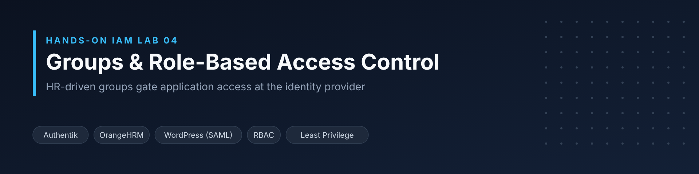

  <strong>Professional Lab Documentation | Identity & Access Management / Cybersecurity</strong>

  
  
  
  

---

## 📌 Project Overview

This lab replaces one-off, per-user access grants with a **rule-based access model**. Department groups derived from HR data (OrangeHRM) are used in the identity provider (Authentik) to decide who can reach a SAML-federated WordPress application.

**The problem:** in many organizations, the honest answer to an auditor's question *"why does this person have this access?"* is *"because someone clicked a button for them."* That access is hard to justify, hard to review and rarely removed when people change roles.

**Why it matters:** when access follows a fact HR already maintains (the employee's department), access changes automatically when the job changes. The result is an environment that can be audited and explained.

**Main objective:** build and prove the first layer of a two-layer RBAC model — *whether* someone can reach an application — and set a least-privilege default for the second layer, *what* they can do once inside.

## 🎯 Objectives

- Design a role model from HR facts (subunits and job titles) rather than from individual requests
- Locate the HR-driven `dept-` groups in Authentik and verify their membership against OrangeHRM
- Gate the WordPress application on group membership so non-members cannot reach it
- Replace a one-off user binding with a group binding
- Prove least privilege by testing both the **allow** case and the **deny** case, including the direct SSO URL
- Demonstrate that access follows an HR department move without changing the access rule
- Distinguish **Layer 1** (application access, enforced at the IdP) from **Layer 2** (in-app permissions, enforced by the application)

## 🏢 Scenario / Business Context

The lab environment already contains employee accounts provisioned from OrangeHRM into Authentik (a joiner/mover process built in an earlier lab), and WordPress single sign-on over SAML. Access to WordPress, however, was granted to a single test user through a per-user binding — an approach that does not scale and leaves no defensible reason for access.

The organization needed a model where:

- Group membership comes from an authoritative source (HR), not a spreadsheet or tickets
- Only members of the approved department can reach WordPress
- Everyone else is refused at the identity provider, not merely hidden from a dashboard tile
- Unmapped SSO users receive the lowest possible privilege inside the application

## 🛠️ Technologies & Tools

| Technology / Tool | Purpose |
|---|---|
| **Authentik** (2026.8.x) | Identity provider: groups, application policy bindings, user impersonation for testing |
| **OrangeHRM** | HR system of record: subunits, job titles and employee list used as the membership source |
| **WordPress** | Target application federated to Authentik via SAML |
| **miniOrange SAML 2.0 SSO plugin** | WordPress SAML service provider; Default Role setting for SSO-created users |
| **SAML 2.0** | Federation protocol between Authentik and WordPress (configured in a previous lab) |
| **Lab Joiner / Mover automation** | Previously built provisioning that creates accounts and maintains `dept-` groups from HR |

## 🏗️ Architecture / Workflow

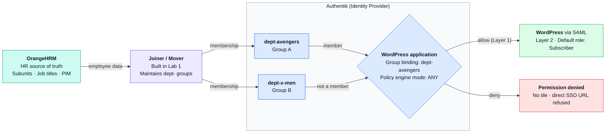

Static image version: <a href="assets/architecture.png">assets/architecture.png</a>

HR is the source of truth. The joiner/mover process turns OrangeHRM subunits into `dept-` groups in Authentik. A **group binding** on the WordPress application (policy engine mode `ANY`) decides who passes **Layer 1**. Members are federated into WordPress, where the plugin assigns a single least-privilege **Default Role** (Layer 2). Non-members — including a user HR moved to another department — are refused with *Permission denied*.

**Lab workflow:**

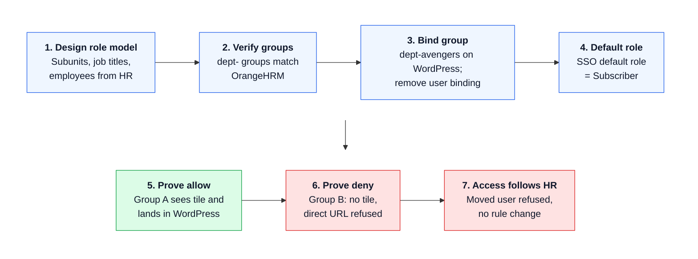

## ⚙️ Implementation / Steps Performed

### Step 1: Design the Role Model from HR Data

The subunits, job titles and employee assignments were read from OrangeHRM (**Admin > Job > Job Titles**, **Admin > Organization > Structure**, **PIM > Employee List**). Two subunits with real members were selected — one to receive WordPress access and one to be denied — so the access rule could be tested in both directions.

| Field | Value |
|---|---|
| Group A (access) | `dept-avengers` |
| Group B (no access) | `dept-x-men` |
| Unmapped SSO default role | Subscriber (lowest WordPress privilege) |

  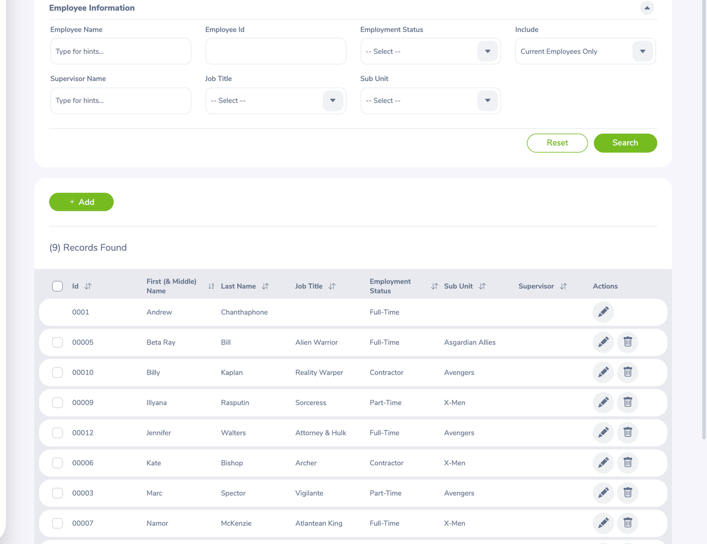
   <em>OrangeHRM employee list – every employee and the subunit they belong to is the membership source.</em>

### Step 2: Locate and Verify the HR-Driven Groups

In **Authentik > Directory > Groups**, the existing `dept-` groups created by the joiner were located. **No groups were created by hand**, avoiding a second, drifting source of truth. Each group's members were compared line-by-line with the matching OrangeHRM subunit.

  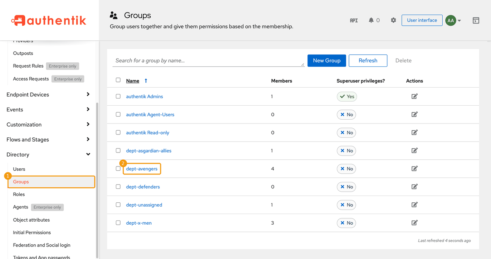
   <em>The HR-built dept- groups in Authentik.</em>

  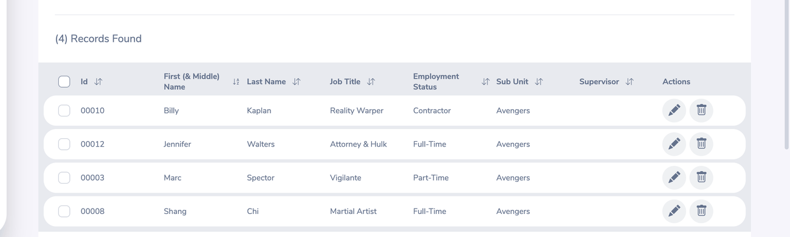
   <em>OrangeHRM filtered to the same subunit – the same four people as Group A.</em>

  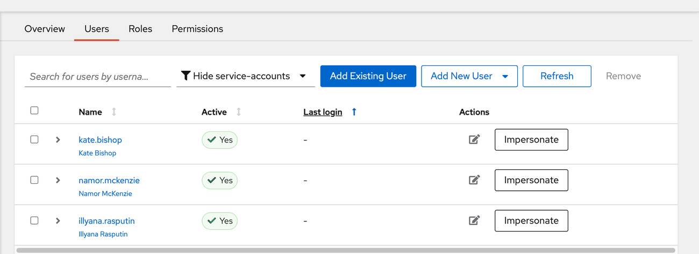
   <em>Group B (dept-x-men) members, including Kate Bishop who was moved by HR in an earlier lab.</em>

### Step 3: Gate WordPress on Group Membership (Layer 1)

On the WordPress application (**Applications > Applications > WordPress > Policy / Group / User Bindings**), `dept-avengers` was bound as a **group binding**, and the leftover per-user binding from the previous lab was deleted. The policy engine mode was confirmed as `ANY`. In WordPress, the miniOrange **Default Role** was confirmed as **Subscriber**, so unmapped SSO users receive the lowest privilege.

  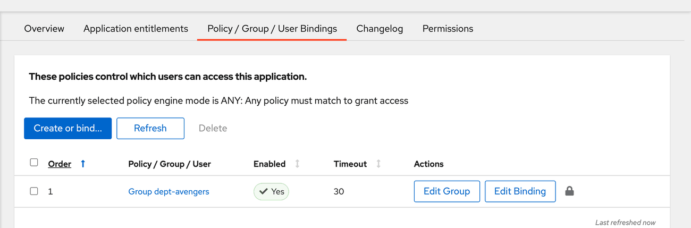
   <em>A single group binding is now the entire access rule.</em>

  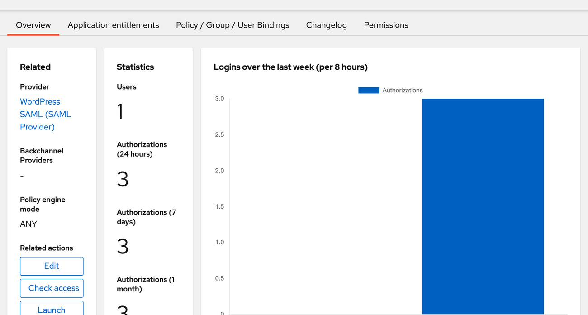
   <em>Policy engine mode ANY – passing one binding grants access.</em>

  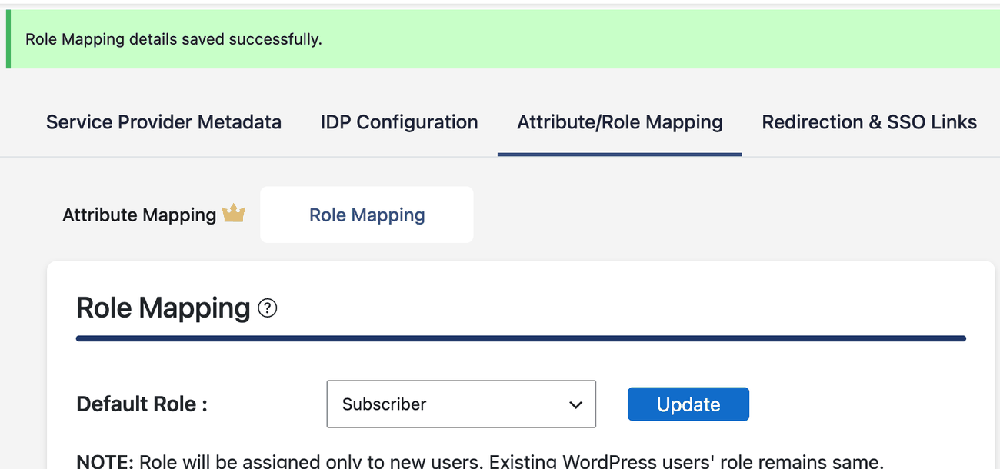
   <em>WordPress SSO default role saved as Subscriber.</em>

### Step 4: Prove the Allow Case

In a private browser window, a Group A member (Marc Spector) signed in to Authentik, saw the WordPress tile and was federated into WordPress.

  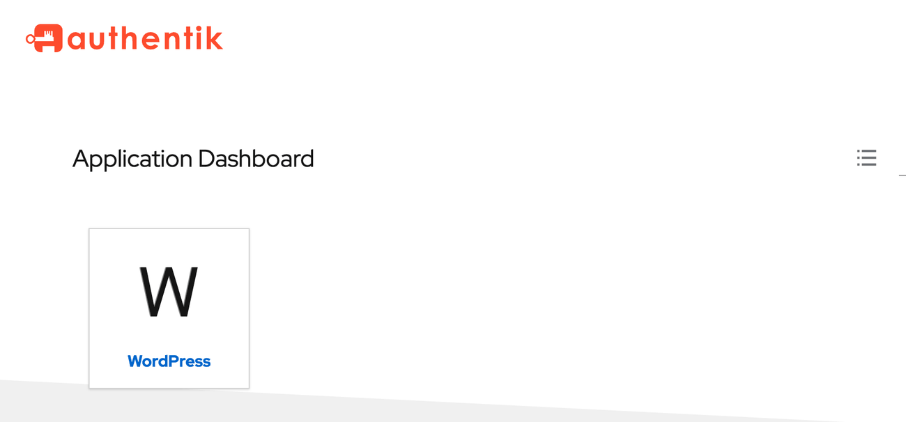
  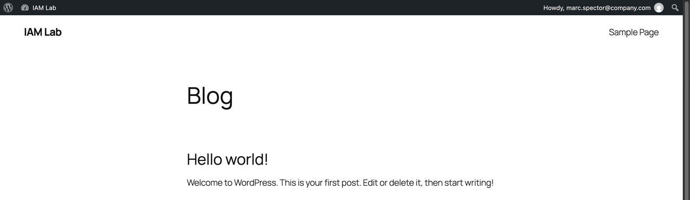
   <em>Group A sees the WordPress tile and lands in WordPress authenticated through Authentik.</em>

### Step 5: Prove the Deny Case

A Group B member (Illyana Rasputin) signed in. The WordPress tile was absent — but because a hidden tile is not access control, the **IdP-initiated SSO URL** was also opened directly. Authentik returned **Permission denied**.

  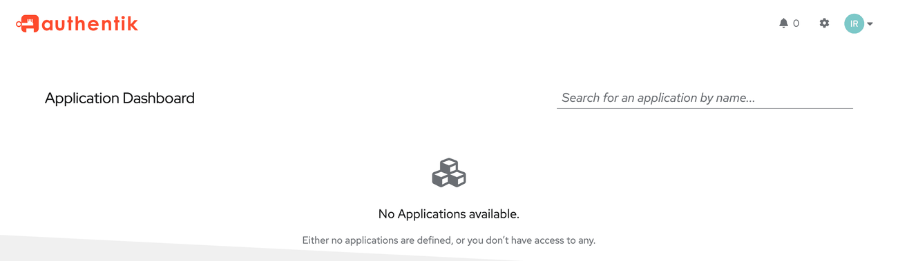
  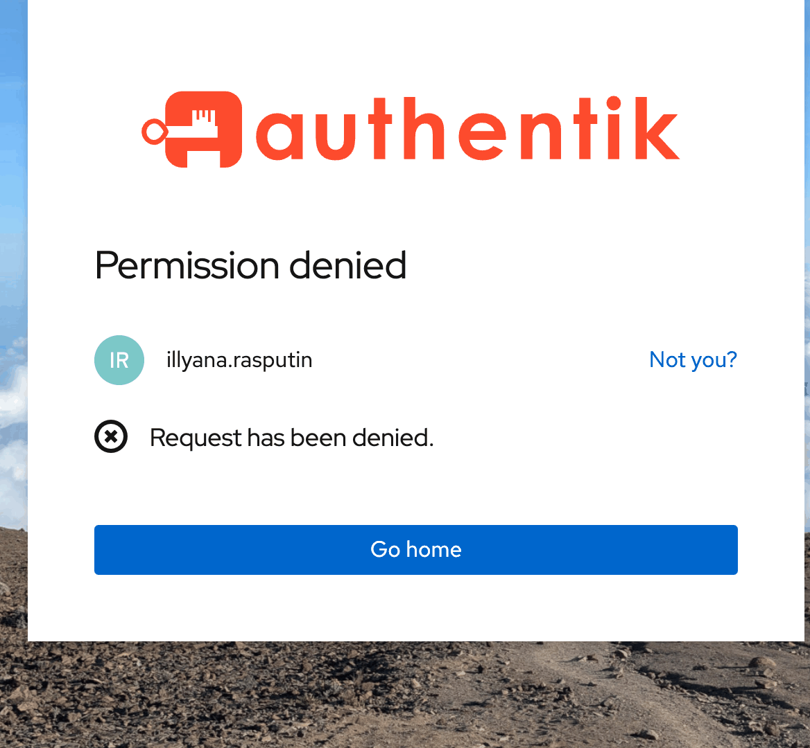
   <em>No tile for Group B, and the direct SSO URL is refused at the identity provider.</em>

### Step 6: Show That Access Follows HR

Kate Bishop had been moved from Avengers to X-Men in HR during an earlier lab. Using Authentik's **Impersonate** feature (with a recorded reason for the audit log), her view was checked: no WordPress tile, and the direct SSO URL was denied. **Nobody changed the binding** — her access changed because HR changed her department.

  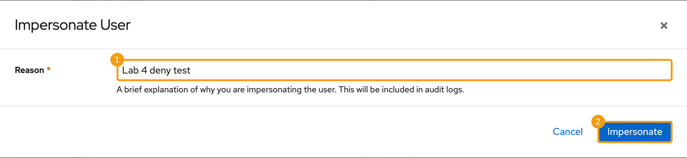
   <em>Impersonation requires a reason, which is written to the audit log.</em>

  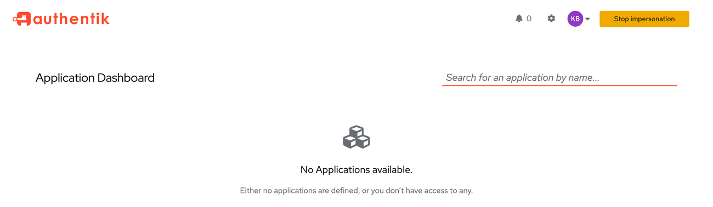
  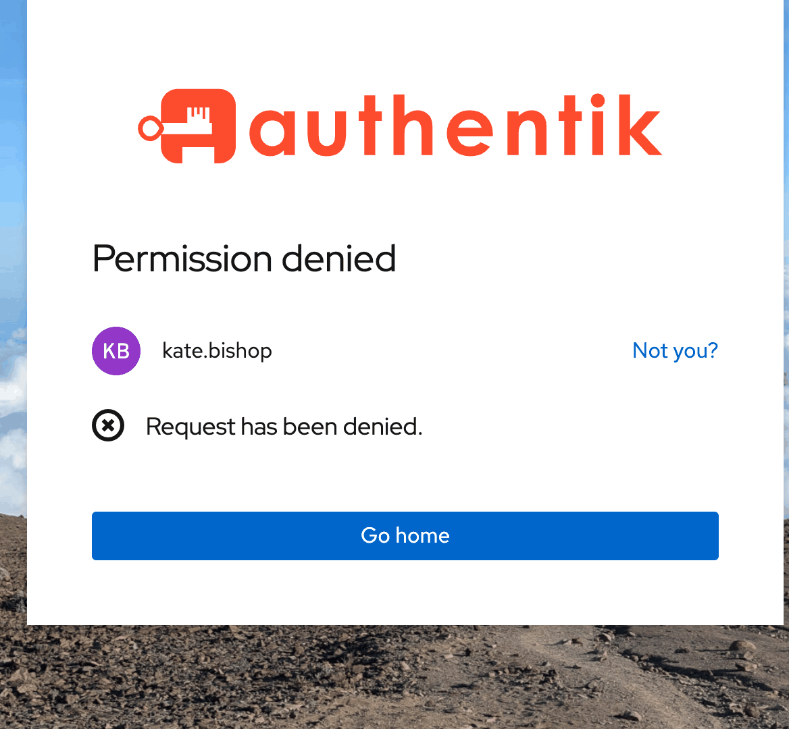
   <em>The moved user sees no WordPress tile and is refused at the direct URL.</em>

## 🔍 Key Findings / Results

- **Access is now rule-based.** One group binding (`dept-avengers`) replaced the per-user binding; the application's access rule is a single row.
- **Membership has a defensible source.** Group members matched OrangeHRM exactly; no one was added manually.
- **Deny is enforced at the IdP, not the UI.** Non-members were refused at the direct IdP-initiated SSO URL, not just hidden from the dashboard.
- **Access followed an HR move automatically.** A user moved between departments lost WordPress access with no change to the access rule.
- **Least-privilege default.** SSO users created in WordPress receive Subscriber. Every SSO user received the same role, which is expected: the free SAML plugin does not map groups to WordPress roles. Per-group roles (Layer 2) are implemented with OIDC in Lab 05 (Grafana).
- **Key rule observed:** an Authentik application with no bindings is open to every user who can log in; adding the first binding closes it to everyone else — including administrators who are not in the bound group.

  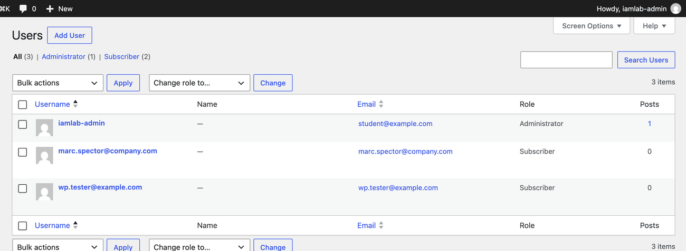
   <em>SSO-created WordPress users hold the Subscriber role; only the local admin is Administrator.</em>

## 🧠 Skills Demonstrated

- Role-based access control (RBAC) design from authoritative HR attributes
- Identity provider administration (Authentik groups, application policy bindings)
- Distinguishing entitlements, roles and groups
- Separating Layer 1 (application access) from Layer 2 (in-app authorization)
- Least-privilege configuration of SAML service-provider defaults
- Negative (deny-case) access testing, including direct-URL bypass attempts
- Joiner/Mover/Leaver awareness and source-of-truth governance
- Auditable admin practices (impersonation with recorded reason)

## 📸 Screenshots & Evidence

| Evidence | What it shows |
|---|---|
| [HR employee list](assets/screenshots/step-01-hr-employee-list.png) | Membership source in OrangeHRM |
| [dept- groups](assets/screenshots/step-02-authentik-dept-groups.png) | HR-driven groups in Authentik |
| [Group binding](assets/screenshots/step-03-group-binding.png) | WordPress gated on `dept-avengers` |
| [Direct URL denied](assets/screenshots/step-05-deny-direct-url.png) | Group B refused at the IdP |
| [Moved user denied](assets/screenshots/step-06-moved-user-denied.png) | Access removed by an HR move |
| [WordPress roles](assets/screenshots/evidence-wordpress-sso-roles.png) | Least-privilege default role applied |

## 💼 Real-World Relevance

- **Enterprise IAM:** the same two-layer pattern underpins Entra ID group-based app assignment with app roles, Okta group rules with app profile mappings, and SailPoint role models over entitlements.
- **Identity lifecycle (JML):** tying access to HR attributes means movers and leavers lose access without relying on someone to file a ticket.
- **Cybersecurity operations:** testing direct URLs, not just UI visibility, reflects how real users and attackers actually reach applications.
- **Compliance and audit:** every grant can be explained by a rule ("members of this department"), making access reviews and certifications practical.

## 📝 Summary

This lab built the first layer of a production-style access model: application access enforced at the identity provider through HR-derived groups. Access was granted by rule, verified against the HR source, and proven with both positive and negative tests — including a user whose access was removed purely by an HR department change. A least-privilege default role was set for the in-application layer, which is extended with claim-based role mapping in the next lab.

## ⚠️ Disclaimer

This project is documented for educational and portfolio purposes. It was performed in a personal lab environment, not in production. Screenshots and scenario details are based on the supplied lab materials (*All Things Identity – Hands-On IAM Labs, Lab 4*). Names shown are fictional test identities.

---

  <strong>Created as part of a professional cybersecurity and IAM portfolio.</strong>

